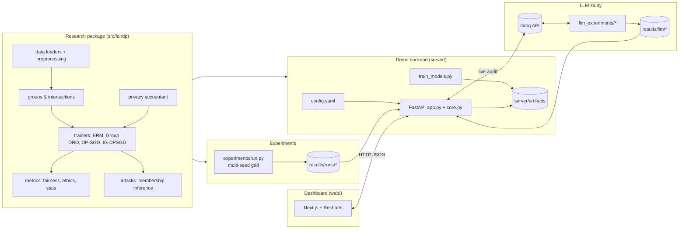

# FairDP: Fairness-Aware Differentially Private Learning & LLM Audit

> **Research question.** Can intersectional fairness be improved in differentially private
> learning under a *fixed* privacy budget? And how do modern LLMs compare on fairness and
> privacy for the same decisions?

This repository contains four things:
1. A **research package**: DP training, fairness metrics, privacy attacks.
2. An **experiment pipeline**: multi-seed grids and statistics.
3. A **live demo system**: a FastAPI backend serving the real trained models, plus a Next.js dashboard.
4. An **LLM study**: how hosted LLMs make the same decisions.

This README explains every part so that any team member can run, present or extend it.

**Contents**
1. [Five-minute quick start](#1-five-minute-quick-start)
2. [Background in plain words](#2-background-in-plain-words)
3. [System architecture](#3-system-architecture)
4. [Repository map](#4-repository-map)
5. [Component guide](#5-component-guide)
   - [5.1 Research package `src/fairdp`](#51-research-package-srcfairdp)
   - [5.2 Our method: IG-DPSGD](#52-our-method-ig-dpsgd)
   - [5.3 Experiment pipeline `experiments/`](#53-experiment-pipeline-experiments)
   - [5.4 Demo backend `server/`](#54-demo-backend-server)
   - [5.5 Dashboard `web/`](#55-dashboard-web)
   - [5.6 LLM study `llm_experiments/`](#56-llm-study-llm_experiments)
   - [5.7 Credit-risk workstream (original notebooks)](#57-credit-risk-workstream-original-notebooks)
6. [Configuration reference](#6-configuration-reference)
7. [API reference](#7-api-reference)
8. [Metrics glossary](#8-metrics-glossary)
9. [Results so far](#9-results-so-far)
10. [Presenting the demo (script)](#10-presenting-the-demo-script)
11. [Testing & quality](#11-testing--quality)
12. [Common tasks (how do I…)](#12-common-tasks-how-do-i)
13. [Troubleshooting](#13-troubleshooting)
14. [Limitations & honest caveats](#14-limitations--honest-caveats)
15. [Roadmap & open work](#15-roadmap--open-work)

---

## 1. Five-minute quick start

**Requirements:** Python 3.12, Node.js 20+ (22 tested), about 2 GB of free disk space and an internet connection on the first run. The first run downloads UCI Adult from OpenML.

### Windows, one click
Double-click **`run_demo.bat`**. On the first run it does all of the following:
- creates `.venv` and installs the Python requirements
- trains and evaluates the 11 demo models (about 4 minutes on CPU)
- installs and builds the dashboard
- starts the API on `:8000` and the dashboard on `:3000`, then opens the browser

Later runs only start the two servers.

### Manual (any OS)
```bash
cd FairDP-Research
python -m venv .venv
.venv/Scripts/activate                 # Linux/Mac: source .venv/bin/activate
pip install -r requirements.txt

# 1) train + evaluate the demo models (once, ~4 min)
cd server && python train_models.py && cd ..

# 2) start the API (terminal 1)
cd server && python -m uvicorn app:app --port 8000

# 3) start the dashboard (terminal 2)
cd web && npm install && npm run build && npm run start
```
Open **http://127.0.0.1:3000**. Interactive API documentation is at **http://127.0.0.1:8000/docs**.

**Optional, for the LLM tab:** create `server/.env` containing `GROQ_API_KEY=gsk_...`. Free keys are available at console.groq.com. The file is gitignored, so never commit keys.

---

## 2. Background in plain words

| Concept | One-sentence explanation |
|---|---|
| **Differential privacy (DP)** | A guarantee that the trained model barely changes whether or not any one person was in the training data. An attacker's odds of telling the difference grow by at most a factor of **e^ε**. |
| **ε (epsilon)** | The privacy budget. Smaller means stronger privacy. We serve models at ε = 1 (strong), 3 and 8 (weak). |
| **δ (delta)** | A tiny probability that the guarantee fails. We use δ = 1/n^1.1, which is about 1e-5. |
| **DP-SGD** | Training with privacy. Each person's gradient is *clipped* to a maximum length, then *Gaussian noise* is added before each update. |
| **Accountant** | The maths that turns noise level, batch size and number of steps into an exact ε. We use Rényi DP (via Opacus). |
| **The problem we study** | Clipping and noise hurt small groups most. Their gradients are clipped more often and drowned by noise, so privacy is *not paid equally*. |
| **Intersectional group** | A combination of attributes, e.g. *Female · Black · 31-50*. Adult has 2 × 3 × 3 = **18** such groups. |
| **Recall / TPR** | Of the people who truly earn > $50k, the share the model identifies. "Worst-group recall" = the lowest recall among the intersectional groups. |
| **Cost of privacy** | How much recall a group loses when we switch from the standard model to a private one. |

**Task used in the demo:** UCI Adult, which predicts whether a person's income exceeds $50k from census attributes. Sensitive attributes are **sex, race and age**. The first workstream used a Kaggle credit-risk dataset (see §5.7).

---

## 3. System architecture



**Key design rules**
- **One source of truth.** Every number on screen comes from the API. Every setting comes from `server/config.yaml`. The dashboard contains no typed-in results.
- **The demo serves the research code.** The backend imports the same `src/fairdp` modules and the same method registry (`experiments/run.py`) as the experiments. What you demo is what you measured.
- **Reproducible.** Fixed seeds, a dataset fingerprint, package versions and training timestamps are recorded (Model cards tab).

---

## 4. Repository map

```
FairDP-Research/
├── README.md                  ← you are here
├── run_demo.bat               one-click demo launcher (Windows)
├── requirements.txt           Python dependencies
│
├── src/fairdp/                RESEARCH PACKAGE (importable library)
│   ├── data/loaders.py        load credit / adult / ACS → common TabularDataset
│   ├── data/preprocess.py     stratified train/val/test split, impute/scale/one-hot, group binning
│   ├── groups.py              group definitions per dataset, intersections, CellIndex
│   ├── models.py              MLP (64→32→1), predict_proba, per-sample loss
│   ├── train.py               non-private trainers: ERM, class-weighted, Group DRO
│   ├── dp/accounting.py       σ calibration for a target ε, joint-mechanism budget split
│   ├── dp/dpsgd.py            unified DP trainer: DP-SGD, DPSGD-F, Global-Adapt, IG-DPSGD
│   ├── postprocess.py         per-group decision thresholds (fitted on validation data)
│   ├── metrics/fairness.py    utility + per-group + intersectional metrics, cost of privacy
│   ├── metrics/ethics.py      four-fifths rule, equalized odds, calibration, consistency, proxy audit
│   ├── metrics/stats.py       bootstrap CIs, paired Wilcoxon + Holm correction
│   └── attacks/mia.py         membership-inference attack (global threshold, per-group)
│
├── experiments/               EXPERIMENT PIPELINE
│   ├── run.py                 grid runner (dataset × method × ε × seed), method registry
│   ├── analyze.py             tables with CIs, significance tests, figures
│   └── configs/*.yaml         smoke / pilot / main / budget_split grids
│
├── server/                    DEMO BACKEND (FastAPI)
│   ├── config.yaml            ALL demo settings (budgets, methods, thresholds, UI ranges…)
│   ├── core.py                training, evaluation, inference, recourse, mitigation, model cards
│   ├── app.py                 HTTP API (validation, live training jobs, LLM proxy)
│   ├── train_models.py        builds server/artifacts (models, probabilities, evaluation)
│   ├── .env                   your API keys (gitignored, optional)
│   └── artifacts/             generated: models/*.pt, probs/*.npz, evaluation.json, …
│
├── web/                       DASHBOARD (Next.js 15 + React 19 + Recharts)
│   ├── src/app/page.tsx       shell: sidebar, tabs, privacy ledger, backend health
│   ├── src/app/globals.css    design tokens + all styles
│   ├── src/lib/api.ts         fetch helpers, useApi hook (cancellation, cache), types
│   ├── src/lib/models.ts      colours per model, labels, number formatting
│   └── src/components/*.tsx   one file per tab (Predict, Overview, Fairness, …)
│
├── llm_experiments/           LLM STUDY
│   ├── clients.py             provider-agnostic client (Groq/Gemini/OpenRouter/HF), disk cache
│   ├── serialize.py           record → prompt text, answer parser
│   └── run_l1_l2.py           L1 (LLM as classifier) + L2 (counterfactual identity swap)
│
├── tests/                     pytest suite (39 tests)
├── docs/
│   ├── EVALUATION.md          full engineering + research evaluation, defects fixed, tech debt
│   └── related_work.md        literature and novelty positioning
├── results/                   experiment outputs (runs/, llm/, original credit CSVs + graphs)
├── data/                      datasets (gitignored; see data/README.md)
├── notebooks/                 original credit-risk notebooks (workstream 1)
└── src/*.py (legacy)          original credit-risk helper code used by the notebooks
```

---

## 5. Component guide

### 5.1 Research package `src/fairdp`

**Data flow:** `load_dataset()` → `prepare()` → trainer → `predict_proba()` → `fairness_report()`.

| Module | What it does | Key functions |
|---|---|---|
| `data/loaders.py` | Loads a dataset into a `TabularDataset`: features, labels, numeric/categorical columns and raw sensitive columns. Supports `credit` (Kaggle CSV, place it in `data/`), `adult` (auto-download) and `acs_income` / `acs_employment` (US Census via folktables, auto-download). | `load_dataset(name)` |
| `data/preprocess.py` | 70/10/20 train/val/test split, stratified on label × group. The imputer/scaler/one-hot encoder is fitted on **train only**, and group thresholds (e.g. income quartiles) are learned on train only. | `prepare(ds, seed)` → `PreparedData` (train/val/test splits, fitted preprocessor and binner) |
| `groups.py` | Turns raw attributes into groups (e.g. age → ≤30 / 31-50 / >50) and builds intersection labels like `Female\|Black\|31-50`. `CellIndex` numbers all cells and knows which marginal groups each cell belongs to. | `get_spec`, `intersect`, `CellIndex` |
| `models.py` | The MLP used everywhere (64 → 32 → 1, ReLU). | `MLP`, `predict_proba`, `per_sample_loss` |
| `train.py` | Non-private references: ERM (standard), class-weighted, **Group DRO** (Sagawa et al. 2020), which up-weights the worst group's loss. | `train_nonprivate` |
| `dp/accounting.py` | Finds the noise σ that gives exactly the target ε. Implements the **budget split**: gradients and group statistics are released together as *one* Gaussian mechanism, so the accounting stays exact. | `calibrate_sigma`, `plan_noise`, `epsilon_for` |
| `dp/dpsgd.py` | One DP training loop with switchable parts (next section). Per-sample gradients come from `torch.func` (vmap). | `train_dp`, `DPConfig` |
| `postprocess.py` | Per-group thresholds that equalise recall, fitted on **validation** data. | `fit_group_thresholds`, `apply_thresholds` |
| `metrics/fairness.py` | Accuracy, balanced accuracy, AUC, ECE; per-group tables; worst-group and gap summaries; differential-fairness ε; cost of privacy per group. Groups need ≥ 30 people and ≥ 10 positives to count. | `fairness_report`, `group_metrics`, `dp_disparate_impact` |
| `metrics/ethics.py` | Responsible-AI metrics: demographic parity, disparate-impact ratio with the **four-fifths rule**, equal opportunity, equalized odds, predictive parity, calibration gap, **individual consistency** (k-NN), and the **proxy audit**. | `group_fairness`, `consistency`, `proxy_audit` |
| `metrics/stats.py` | Mean with a bootstrap 95% CI over seeds; paired Wilcoxon tests vs a reference method with Holm correction. | `aggregate`, `paired_tests` |
| `attacks/mia.py` | Membership-inference attack: "low loss ⇒ was in training". It reports AUC, plus advantage per group at one **global** threshold (disparate vulnerability). | `loss_threshold_mia` |

### 5.2 Our method: IG-DPSGD

**IG-DPSGD** (Intersectional Group-robust DP-SGD) is DP-SGD plus the four components below.

1. **Private group statistics.** At each step, the batch's per-cell counts and clipped losses are released with Gaussian noise. Cells = intersection × label, so 36 on Adult.
2. **Hierarchical smoothing.** Small cells are noisy, so each cell's estimate is pulled toward its parent groups (sex, race, age) and the overall mean. This uses only already-noisy numbers, so it is free privacy-wise (post-processing).
3. **Group-DRO reweighting.** Cells with higher (smoothed) loss get larger weights through an exponentiated-gradient update, starting from plain training. Weights are normalised to stay ≤ 1, so each person's influence, and therefore the privacy maths, is unchanged.
4. **Exact joint accounting.** The gradient and the statistics form one Gaussian mechanism:
   `1/σ_eff² = 1/σ_grad² + k/σ_stats²`. A **budget split ρ** (default 5%) says what share of the privacy loss pays for the statistics. Total ε stays exactly the target.

**Ablations and baselines** in `experiments/run.py` → `PRIVATE`:

| ID | Description |
|---|---|
| `dpsgd` | plain DP-SGD (baseline) |
| `dpsgd_balanced` | DP-SGD + private label re-balancing (control) |
| `dpsgd_f` | DPSGD-F-style group clipping (Xu et al. 2021) |
| `global_adapt` | Global-Adapt-style scaling (Esipova et al. 2023) |
| `ig_dpsgd` | **ours**: DRO + smoothing |
| `ig_no_smoothing` | ablation: without smoothing |
| `ig_global_adapt` | ours + Global-Adapt clipping |
| `ig_single_attr` | ablation: DRO over one attribute instead of intersections |

**Known weakness (be ready to explain).** With about 256 people per batch spread over 36 cells, each cell sees only about 3–7 people per step. The noisy statistics are therefore mostly noise for small cells, which is why simple **label balancing** reaches a higher worst-group recall on Adult. See §9 and §14.

### 5.3 Experiment pipeline `experiments/`

```bash
python experiments/run.py --config experiments/configs/smoke.yaml     # quick check
python experiments/run.py --config experiments/configs/pilot.yaml     # Adult, 5 seeds (pilot_v2)
python experiments/run.py --config experiments/configs/main.yaml      # paper grid: 3 datasets × 11 methods × ε{1,3,8} × 10 seeds
python experiments/analyze.py --run pilot_v2                          # CIs, Wilcoxon/Holm tests, figures
```
- **Resumable.** Finished runs are skipped, so you can stop and restart.
- **Outputs** go to `results/runs/<name>/`:
  - `summary.parquet`: one row per run × {raw threshold, post-processed}
  - `groups.parquet`: per-group tables
  - `mia.parquet`: membership-attack results
  - `analysis/`: tables and figures written by `analyze.py`
- **Statistics.** Each seed changes both the data split and the model initialisation. With 5 seeds, Wilcoxon tests *cannot* reach p < 0.05, so claims need the 10-seed `main` grid.

### 5.4 Demo backend `server/`

| File | Role |
|---|---|
| `config.yaml` | Every setting of the demo (see §6). |
| `core.py` | Loads data with the configured seed and split, trains models, evaluates them (fairness + ethics + attack), scores applicants, computes counterfactuals and **recourse**, applies **mitigation** thresholds, and writes **model cards** and **provenance**. |
| `train_models.py` | Builds `server/artifacts/`. `--force` retrains everything; `--reeval` recomputes metrics for saved models without retraining. |
| `app.py` | FastAPI routes, input validation (bad input → 4xx, never a crash), live training jobs in a background thread, and the LLM proxy. Loads `server/.env` at start-up. |

**Artifacts** (generated, not hand-edited):

| Path | Contents |
|---|---|
| `models/<method>__eps<ε>.pt` | model weights |
| `probs/*.npz` | validation and test probabilities, used by mitigation without re-running models |
| `evaluation.json` | all metrics per model |
| `training.json` | noise plans, per-epoch history, timestamps |
| `proxy.json` | proxy audit + "blind" model |
| `study.json` | multi-seed summary of the configured experiment run |

### 5.5 Dashboard `web/`

Built with Next.js (App Router), TypeScript and Recharts. All data comes from `/api/*`.

| Section | Tab | What it shows / how to use it |
|---|---|---|
| Demo | **Decision demo** | Pick a real applicant: the list is selected automatically as the people the models disagree about most. Every model scores them live. Then see the **counterfactual grid** (same person, every sex × race), **algorithmic recourse** (cheapest realistic change to get approved, compared with the majority identity), a per-field **explanation**, and how each model treats this person's group. |
| Analysis | **Overview** | Headline numbers, system pipeline, model comparison, worst-group recall vs ε, full metrics table. |
| | **Fairness** | Fairness suite per attribute (four-fifths rule, equal opportunity, equalized odds, predictive parity, calibration, consistency); recall/FPR/selection rate by group; cost of privacy per group; calibration chart; intersectional heatmap. |
| | **Privacy** | Live accountant (σ, batch, epochs → ε, with σ needed for each budget); multi-seed privacy–utility trade-off; membership attack overall and per group; exact noise settings of each served model. |
| Responsible AI | **Mitigation** | Three decision policies on the same model: one threshold, equal opportunity, demographic parity. It shows the **fairness impossibility trade-off** live, plus a threshold sweep. |
| | **Proxy audit** | How well the other features reveal sex/race (AUC, top proxy features), and a model trained *without* sex/race ("fairness through unawareness"). |
| | **Scorecard** | Pass/fail checks per model: privacy, fairness, transparency, accountability, robustness. Thresholds come from config. |
| | **Model cards** | Generated model card (downloadable `.md`) + provenance: data fingerprint, code version, package versions, training log. |
| Experiments | **Train live** | Starts a real training job on the backend; per-epoch accuracy, worst-group recall and ε spent. Runs are kept for comparison. |
| | **LLM audit** | Prompt built from a real record; live counterfactual audit against an LLM; measured **L1/L2** results next to our models. |
| | **Credit study** | The first workstream's DP results on credit data. |

**The privacy ledger** in the top bar shows the current ε, δ, the odds bound e^ε and the number of training people. Changing the ε selector updates every tab.

**Code conventions**
- One component per tab.
- `useApi(path)` handles fetching, caching and stale-response protection.
- `useMeta()` exposes config-driven helpers (method names, ε list, task labels).
- Colours follow the model, not its rank (`lib/models.ts`).

### 5.6 LLM study `llm_experiments/`

| Experiment | Status | What it measures |
|---|---|---|
| **L1** LLM as classifier | ✅ results | The same Adult test people (same split and seed) as text prompts; same metrics as our models. |
| **L2** Counterfactual consistency | ✅ results | Same prompt plus an explicit race × sex statement (8 identities); decision flip rate, positive-rate gap. |
| L3 Multilingual | planned | Decisions in English/Hindi/Spanish + one more language. |
| L4 Bias benchmarks | planned | BBQ, DiscrimEval. |
| L5 Privacy leakage | planned | PII in context, Min-K% membership inference. |
| L6 DP fine-tuning | stretch | DP-LoRA with canaries. |

```bash
# needs GROQ_API_KEY in the environment (or server/.env for the dashboard)
python llm_experiments/run_l1_l2.py --dataset adult --provider groq --model openai/gpt-oss-20b --n 200 --n_cf 40 --seed 0
```
- **Every response is cached** in `llm_experiments/cache/`. Re-running costs nothing, and an interrupted run resumes where it stopped.
- **The client is robust:** it retries rate limits and network errors, sets a User-Agent (Groq requires one), and keeps reasoning models' chain-of-thought out of the answer.
- **Results** go to `results/llm/<dataset>__<model>/` (`l1_*.csv`, `l2_*.csv`). The dashboard picks them up automatically.

### 5.7 Credit-risk workstream (original notebooks)

`notebooks/` and the legacy `src/*.py` hold the team's first study:
- **Data:** Kaggle credit-risk data, predicting loan default, with groups by age, income and homeownership.
- **Models:** LR, MLP, class-weighted MLP and DP-MLP at σ = 1.0 / 1.5 / 2.0, i.e. ε = 1.33 / 0.66 / 0.46.
- **Results:** in `results/*.csv` and `results/graphs/`; the dashboard shows them in **Credit study**.
- **To re-run:** place `credit_risk_dataset.csv` in `data/` (see `data/README.md`).
- **Write-ups:** `FairDP_Project_Progress_and_File_Guide.md`, `FairDP_Results_Interpretation.md`.

---

## 6. Configuration reference

`server/config.yaml` controls the demo. Restart the API after changing it. Retrain with `train_models.py --force` when a setting that affects training changes.

| Key | Meaning |
|---|---|
| `dataset`, `seed`, `split` | which data, random seed, val/test fractions |
| `model.hidden`, `epochs` | MLP layers, training epochs |
| `decision_threshold` | probability cut-off for a positive decision |
| `task` | labels used in the UI, e.g. "income > $50k" |
| `epsilons` | privacy budgets of the served models |
| `train_epsilons`, `train_epochs` | options offered in **Train live** |
| `dp`, `nonprivate` | optimiser settings (batch size, learning rate, clipping norm) |
| `methods` | served models: `id` (from the registry in `experiments/run.py`), display names, `baseline: true`, `ours: true` |
| `study_run` | which `results/runs/<name>` provides the multi-seed evidence |
| `demo.n_samples` | number of auto-selected applicants |
| `recourse` | actionable features and their cost per step |
| `scorecard` | pass/fail thresholds: four-fifths ratio, equalized-odds max, calibration max, consistency min, attack-AUC max, ε max |
| `proxy_audit`, `proxy_strength` | attributes audited, AUC cut-offs for "strong/moderate proxy" |
| `threshold_grid`, `accountant` | slider ranges in the UI |
| `cors_origins` | which web origins may call the API |

---

## 7. API reference

Interactive documentation is at `http://127.0.0.1:8000/docs`. All responses are JSON unless noted.

| Method & path | Purpose |
|---|---|
| `GET /api/health` | liveness + number of served models |
| `GET /api/meta` | config, form schema, served models, auto-selected applicants, dataset info |
| `POST /api/predict` `{applicant, eps}` | every model's decision + explanation, recourse, counterfactual grid |
| `GET /api/evaluation` | all test-set metrics per model (utility, groups, ethics, attack, cost of privacy) |
| `GET /api/study` | multi-seed summary (mean ± sd) |
| `GET /api/training` | noise plans, per-epoch history, timestamps |
| `GET /api/accountant?sigma&batch&epochs` | ε for a DP-SGD configuration + σ needed per budget |
| `GET /api/mitigation?method&eps&policy&attr&t` | metrics after a threshold policy (`single` / `equal_opportunity` / `demographic_parity`) |
| `GET /api/sweep?method&eps&attr` | metrics across thresholds |
| `GET /api/proxy` | proxy audit + unawareness model |
| `GET /api/scorecard?eps` | responsible-AI checks per model |
| `GET /api/model_card?method&eps` | model card (Markdown text) |
| `GET /api/provenance` | dataset fingerprint, git commit, package versions, training log |
| `POST /api/train` `{method, eps, epochs}` → `GET /api/train/{id}` | live training job and its progress |
| `GET /api/credit` | first-workstream credit results |
| `GET /api/llm` | LLM results (L1/L2), experiment status, available provider models |
| `POST /api/llm/prompt` `{applicant}` | the exact prompt that would be sent |
| `POST /api/llm/query` `{applicant, provider, model}` | live counterfactual audit against an LLM |

**Invalid input** (unknown category, out-of-range number, bad attribute) returns **400/422** with a readable message.

---

## 8. Metrics glossary

| Metric | Definition | Good value |
|---|---|---|
| Accuracy / balanced accuracy | share correct / mean of TPR and TNR | higher |
| Worst-group recall | lowest TPR among intersectional groups with ≥ 30 people and ≥ 10 positives | higher |
| Group recall gap | best − worst group TPR | lower |
| Cost of privacy (worst-hit group) | max over groups of TPR(standard) − TPR(private model) | lower |
| Demographic parity difference | max − min selection rate across groups | lower |
| Disparate-impact ratio | min selection rate ÷ max selection rate | ≥ 0.8 passes the **four-fifths rule** |
| Equal opportunity difference | max − min TPR | lower |
| Equalized odds difference | max(TPR gap, FPR gap) | lower |
| Predictive parity difference | max − min precision | lower |
| Calibration gap | spread of (mean score − actual rate) across groups | lower |
| Individual consistency | 1 − mean decision difference to the 10 nearest neighbours | higher (1 = similar people treated alike) |
| Differential fairness ε | largest log-ratio of positive rates between groups (Foulds et al.) | lower |
| Membership-attack AUC | can an attacker tell training members apart? | 0.5 = no leakage |
| Attack advantage per group | TPR − FPR at one global attack threshold | ≈ 0 |
| Proxy AUC | how well the other features predict a sensitive attribute | 0.5 = no proxy |

---

## 9. Results so far

All results below are on UCI Adult, using the served models (seed 0) plus the 5-seed pilot.

| Model | Privacy | Accuracy | Balanced acc. | Worst-group recall | Scorecard |
|---|---|---|---|---|---|
| Standard | none | 85.5% | 78.4% | 44.2% | 7/11 |
| DP-SGD | ε = 1 | 84.7% | 74.1% | 41.2% | 8/11 |
| DP-SGD + label balancing | ε = 1 | 79.5% | 82.4% | 66.7% | 5/11 |
| **IG-DPSGD (ours)** | ε = 1 | 83.8% | 79.6% | **51.8%** | 7/11 |
| gpt-oss-20b (LLM) | none | 75.0% | 67.1% | 33.3% | – |
| qwen3.8-27b (LLM) | none | 73.0% | 62.5% | 25.0% | – |

**Key findings**
1. **Privacy is not paid equally.** DP-SGD's worst-hit group loses about 22 percentage points of recall vs the standard model. IG-DPSGD cuts this to about 14 points at ε = 1 and about 5 points at ε = 8.
2. **IG-DPSGD is a trade-off, not a free win.**
   - Against DP-SGD at the same ε it raises worst-group recall (41% → 52%), keeps accuracy within 1 point, and cuts the cost of privacy.
   - Its group reweighting miscalibrates scores across race groups (calibration gap 0.077 vs 0.016). That single check is why DP-SGD passes one more scorecard check (8 vs 7 at ε = 1).
   - Label balancing reaches higher worst-group recall (67%) but loses 5 points of accuracy and fails more checks (5/11).
   - The scorecard counts checks equally; it is not a single "fairness score".
3. **Every model fails the four-fifths rule for sex.** Base rates differ strongly between men and women in Adult.
4. **The fairness impossibility trade-off is visible.** Demographic-parity thresholds pass the four-fifths rule but lower worst-group recall. Equal-opportunity thresholds do the reverse.
5. **Fairness through unawareness fails.** The other features reveal sex with AUC 0.93. Removing sex and race *lowers* worst-group recall (44% → 40%).
6. **LLMs are less accurate, less fair to the worst group, and identity-sensitive.** Adding only a race × sex statement flips 10–17.5% of gpt-oss-20b decisions. For Qwen, "Black woman" gets the lowest positive rate (5% vs 17.5% for "White woman").
7. **No measurable membership leakage** for any served model (attack AUC ≈ 0.50).

Full details and caveats: `docs/EVALUATION.md`.

---

## 10. Presenting the demo (script)

Roughly 10 minutes; adapt as needed.

1. **Decision demo** (3 min)
   - Pick an applicant and point at the decision cards: the private models disagree with the standard one.
   - Scroll to the **counterfactual grid**: does the decision change when only sex or race changes?
   - Show **recourse**: what would this person need to change, and is it the same for the majority identity?
2. **Privacy** (1 min): move the σ slider and watch ε change. Explain the privacy ledger (odds ≤ e^ε).
3. **Overview → Fairness** (2 min): worst-group recall vs ε, cost of privacy per group, the four-fifths rule table.
4. **Mitigation** (1.5 min): switch between the three policies. No policy wins on every criterion.
5. **Proxy audit** (1 min): "Why not just remove race and sex?" AUC 0.93, and the blind model is worse.
6. **Scorecard / Model cards** (1 min): accountability, a downloadable model card, provenance.
7. **LLM audit** (1 min): run the live audit, then show the L1/L2 table vs our models.
8. **Optional, Train live:** start a 2-epoch run (about 15 s) to show it is real.

**Likely questions**
- *"Why does label balancing beat your method?"* Noise dominates the per-group statistics for small groups (§5.2). The next version builds the reweighting on top of balancing.
- *"Why does DP-SGD pass more scorecard checks?"* One check: race calibration. Reweighting groups shifts the score scale between groups. That's the known tension between equal recall and calibration (Kleinberg et al.), and you can show it live in the Mitigation tab.
- *"Is preprocessing private?"* No. The guarantee covers training only (§14).
- *"How many seeds?"* The served models use 1 seed. The pilot uses 5, which is not enough for significance. The main grid uses 10.

---

## 11. Testing & quality

```bash
pytest -q          # 39 tests, ~45 s
```

| Test file | Covers |
|---|---|
| `test_dp.py` | accountant vs Opacus reference values, per-sample gradients vs Opacus, DP weight/sensitivity invariants, trainer sanity |
| `test_groups_and_metrics.py` | group binning, splits, metrics vs fairlearn, bootstrap/Holm |
| `test_ethics.py` | four-fifths rule, calibration gap, consistency, proxy audit |
| `test_api.py` | API contracts plus regression tests for every fixed defect (invalid input, path traversal, out-of-range parameters, step-count consistency). Requires `server/artifacts`. |
| `test_llm_parse.py` | LLM answer parsing |

Frontend:
```bash
cd web
npm run lint
npm run build      # also type-checks
```
End-to-end checks were run with Playwright across all tabs (0 console errors). Committing them as a test suite is on the roadmap.

---

## 12. Common tasks (how do I…)

| Task | Steps |
|---|---|
| …change the privacy budgets shown in the demo? | Edit `epsilons` in `server/config.yaml`, then run `python server/train_models.py --force` and restart the API. |
| …add a new method to the demo? | 1. Add it to `PRIVATE` or `NONPRIVATE` in `experiments/run.py`. 2. Add `{id, name, short}` under `methods` in `config.yaml`. 3. Run `train_models.py`, restart the API. |
| …change a pass/fail threshold? | Edit `scorecard` in `config.yaml` and restart the API. |
| …refresh metrics after changing metric code (no retraining)? | `python server/train_models.py --reeval`, then restart the API. |
| …use a different multi-seed run as evidence? | Set `study_run` in `config.yaml`, then run `train_models.py --reeval`. |
| …run the LLM study on another model? | Run `run_l1_l2.py --model <id>`. The dashboard lists the models available to your key. |
| …add a dashboard tab? | Create `web/src/components/MyTab.tsx` and register it in `TABS` and `render()` in `web/src/app/page.tsx`. |
| …run the full paper grid? | `python experiments/run.py --config experiments/configs/main.yaml` (hours on CPU; resumable), then `python experiments/analyze.py --run main`. |

---

## 13. Troubleshooting

| Symptom | Fix |
|---|---|
| Dashboard shows "Can't reach the FairDP backend" | Start the API (`cd server && python -m uvicorn app:app --port 8000`). The page reloads itself when the API comes back. |
| API returns 503 "Artifacts missing" | Run `python server/train_models.py`. |
| `EADDRINUSE` / port already in use | An old server is still running. Close its terminal, or on Windows: `Get-NetTCPConnection -LocalPort 3000 \| % { Stop-Process -Id $_.OwningProcess }`. |
| LLM tab says "no key" | Put `GROQ_API_KEY=...` in `server/.env` and restart the API. |
| LLM call returns 403 | The provider blocked the client. Our client sets a User-Agent; make sure you're on the current `clients.py`. |
| LLM model "does not exist" | Providers retire models. Pick one from the dropdown, which lists your key's models. |
| A batch LLM run stopped half-way | Re-run the same command. Cached answers are reused. |
| Numbers didn't change after editing `config.yaml` | Restart the API, and retrain if training settings changed. |
| Credit study cannot be re-run | `data/credit_risk_dataset.csv` is not in the repo (Kaggle licence). Download it into `data/`. |

---

## 14. Limitations & honest caveats

- **Scope of the privacy guarantee:** it covers *model training* only. Preprocessing statistics (scaler, encoder), the list of group categories, validation data used for thresholds, and hyperparameter selection are **not** private.
- **Statistical strength:**
  - Served models use one seed; the pilot uses 5.
  - With 5 seeds, Wilcoxon tests cannot reach significance.
  - There are no per-group confidence intervals yet.
- **Data:**
  - Adult's race and sex categories are coarse.
  - Several intersectional groups are tiny; they are shown faded and excluded from gaps.
  - The credit data has no race or sex.
- **Fairness is not causality:** gaps describe outcomes; they do not prove discrimination.
- **LLM study:** small samples (200 / 40 people), two models, zero-shot English only.
- **The demo is local-only:** there is no authentication and CORS is restricted to localhost. Do not expose it to the internet.

---

## 15. Roadmap & open work

| Priority | Item |
|---|---|
| 1 | **Commit all work.** Everything since the initial commit is uncommitted. |
| 2 | Run the **main grid** (Adult + ACS, 10 seeds) for significance-tested claims. |
| 3 | **IG-DPSGD v2:** reweight on top of label balancing; target positive-class loss. |
| 4 | LLM experiments **L3–L5** (multilingual, benchmarks, leakage). |
| 5 | Per-group bootstrap CIs; LiRA membership attack; commit the Playwright E2E suite. |
| 6 | Re-run the credit study inside the new pipeline (needs the Kaggle CSV). |

See `docs/EVALUATION.md` §3 for the full prioritised tech-debt list.
